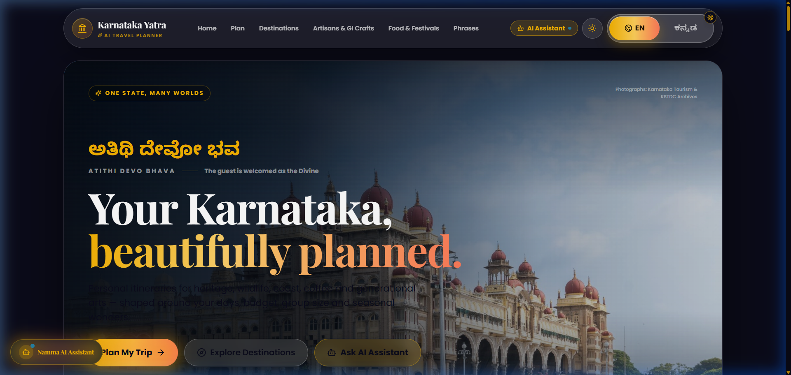
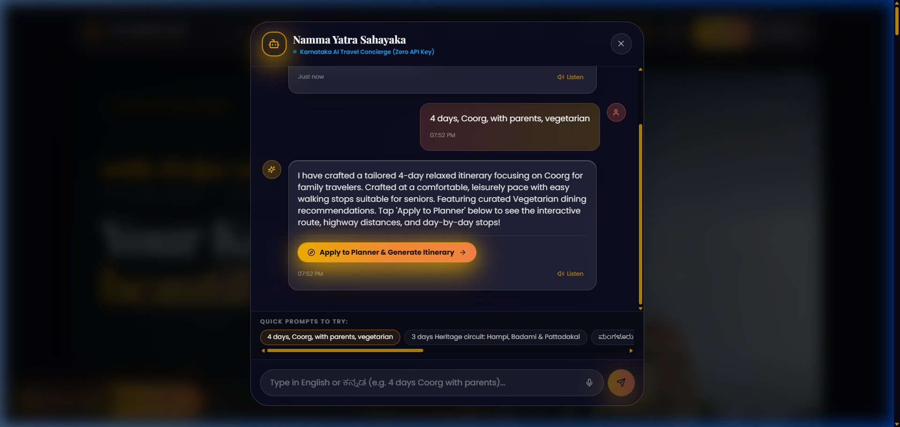
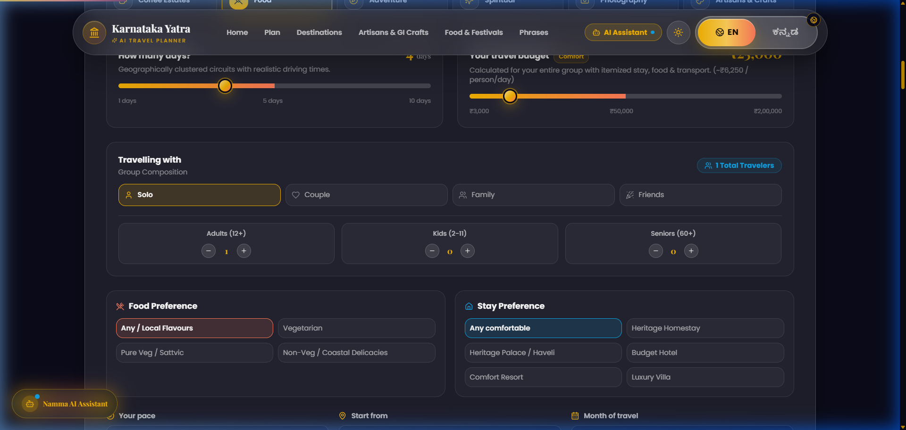
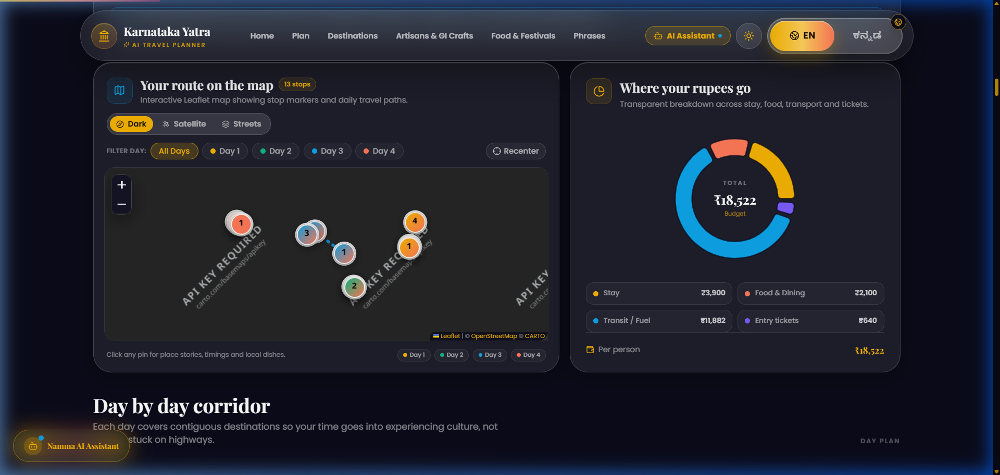
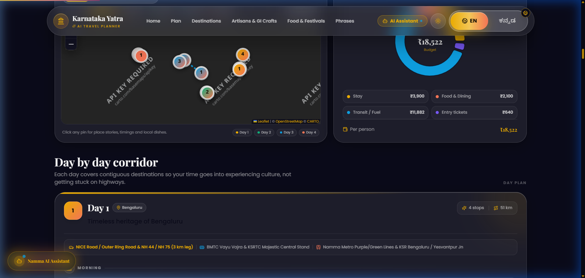
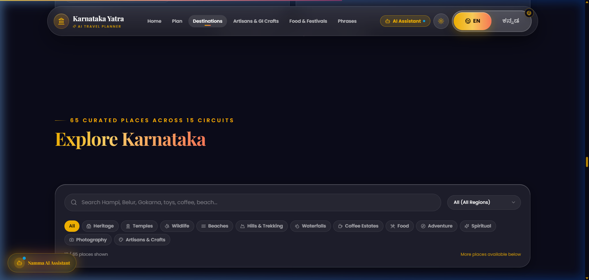

# Namma Yatra (ಕರ್ನಾಟಕ ಯಾತ್ರೆ)
### AI Cultural Travel Concierge & Heritage Corridor Engine for Karnataka

> **Kannada Digital Innovation Hackathon 2026 — Problem Statement 06: Travel & Tourism**  
> **Ethos:** *ಅತಿಥಿ ದೇವೋ ಭವ (Atithi Devo Bhava — The guest is welcomed as the Divine)*

---

## 🌟 Visual Showcase

<div align="center">

### 1. Cultural Hero & Regional Circuits


### 2. Namma Yatra Sahayaka (Zero-API Private AI Travel Assistant)


### 3. Demographic Planner & Live Seasonal Advisory


### 4. Realistic Itinerary & Interactive Leaflet Route Map


### 5. Day Transit Corridors & KSRTC / Train Connections


### 6. 15-Circuit Heritage Catalog with Smart Pagination


</div>

---

## 💡 What Makes Karnataka Yatra Unique?

1. **Zero-API Private AI Concierge ("Namma Yatra Sahayaka"):**
   - Natural language input in English and ಕನ್ನಡ (e.g., *"4 days, Coorg, with parents, vegetarian"* or *"ಮಂಗಳೂರು ಮತ್ತು ಗೋಕರ್ಣ ೩ ದಿನ ಕಡಲತೀರ ಪ್ರವಾಸ"*).
   - Operates **100% in-browser with zero paid external API dependencies**. No API keys needed for production Vercel deployment.
   - 1-click **"Apply to Planner & Generate Itinerary"** bridge.
   - Integrated bilingual speech recognition (`kn-IN`, `en-IN`) and native audio playback.

2. **Geographically Accurate 15-Circuit Engine:**
   - Corrects common geographical errors by organizing the state into 15 real districts/circuits:
     *Bengaluru, Mysuru, Mangaluru, Uttara Kannada, Chikkamagaluru, Hassan, Shivamogga, Coorg, Hampi, Hubballi-Dharwad, Badami, Vijayapura, Kalaburagi, Chitradurga, Belagavi.*
   - Proximity-weighted routing prevents unrealistic cross-state leaps.
   - Fixed misclassifications (Gol Gumbaz belongs to Vijayapura under Heritage/Spiritual; Bidar Fort to Kalaburagi; Gokarna/Murudeshwar to Uttara Kannada; Belur/Halebidu to Hassan; Jog Falls to Shivamogga).

3. **Demographic Group Budgeting & Stay Preferences:**
   - Dedicated counters for **Adults, Children, and Seniors**.
   - Accurately adjusts entry fees (child discounts, free senior entries) and room sharing costs.
   - Dietary filters (Pure Veg / Sattvic, Veg, Non-Veg) and stay preferences (Homestays, Heritage, Budget, Luxury).

4. **Live Seasonal Warnings & 2026 Calendar Sync:**
   - Dynamic seasonal alerts: Western Ghats monsoon warnings (June–Sept), Jog Falls peak flow windows (July–Oct), and coastal Kambala buffalo racing season (Nov–March).
   - All monument ticket rates and festival timings verified for the **2026 Tourism Calendar** (KSTDC / ASI).

5. **Transit Corridors & 1-Click Sharing:**
   - Real-world travel guidance between consecutive stops: driving distances (km), driving hours, and public transit links via **KSRTC Airavat / Rajahamsa express buses** and **South Western Railway trains**.
   - Instant 1-click **WhatsApp Itinerary Export** (`https://api.whatsapp.com/send?text=...`) and formatted **PDF Download**.

6. **Generational GI Artisans & Kannada Cultural Living Heritage:**
   - Dedicated showcase celebrating Karnataka's GI-tagged craft clusters:
     *Channapatna wooden lacquer toys, Bidriware silver inlay, Ilkal sarees, Mysore silk, Kinnal art, and Kasuti embroidery.*
   - Authentic regional cuisine guide mapped across all 15 regions.
   - **24-phrase Travel Kannada Phrasebook** with audio pronunciation playback.

7. **Accessibility, Themes & Offline PWA:**
   - High-contrast **Dark Glassmorphic Theme** and clean **Light Theme** with persistent state.
   - Accessible heading hierarchy (`<h2>` $\to$ `<h3>`), `lang="kn"` tags on Kannada text, and deep-linkable URLs (`#place-[id]`).
   - Progressive Web App (PWA) manifest for offline performance in low-connectivity tourist belts.

---

## 🛠️ Technology Stack

- **Framework:** Next.js 14 (App Router)
- **Language:** TypeScript 5.6
- **Styling:** Tailwind CSS & Glassmorphism Design Tokens
- **Animations:** Framer Motion
- **Maps:** Leaflet & React-Leaflet
- **Speech & Audio:** Web Speech API (Recognition & Synthesis) with Phonetic Fallback
- **Export Engines:** jsPDF & html2canvas for PDF export; native WhatsApp sharing URI
- **Deployment:** Vercel (100% serverless, zero API keys required)

---

## 🚀 Quick Start Guide

### Prerequisites
- Node.js 18.17+ or newer
- npm or yarn

### Installation

```bash
# Clone the repository
git clone https://github.com/sustik78/Karnataka_Karnataka_Yatra_Hackathon.git

# Navigate to project directory
cd Karnataka_Karnataka_Yatra_Hackathon

# Install dependencies
npm install

# Run the local development server
npm run dev
```

Open [http://localhost:3000](http://localhost:3000) in your browser.

### Windows 1-Click Launcher
Double-click `run.bat` in the repository root to verify Node.js, install missing packages, and launch the dev server automatically.

### Production Build

```bash
npm run build
npm start
```

---

## 📁 Repository Structure

```
├── app/                  # Next.js App Router (layout, globals.css, page)
├── components/           # UI components
│   ├── AiAssistantChat.tsx  # Zero-API bilingual AI concierge modal
│   ├── ArtisansSection.tsx  # GI-tagged local crafts showcase
│   ├── DayCard.tsx          # Itinerary stop cards with transit options
│   ├── Destinations.tsx     # 15-region catalog with pagination
│   ├── Hero.tsx             # Cultural greeting and stats
│   ├── ItineraryResult.tsx  # Route map, budget breakdown, WhatsApp export
│   ├── LanguageToggle.tsx   # Instant Kannada/English switcher
│   ├── Navbar.tsx           # Navigation with Theme and AI assistant buttons
│   ├── PhrasesCard.tsx      # 24-phrase interactive audio phrasebook
│   ├── PlannerForm.tsx      # Group demographic & corridor planner
│   ├── ThemeToggle.tsx      # Light/Dark mode switcher
│   └── YatraApp.tsx         # Main application coordinator
├── data/
│   ├── photos.ts         # Verified photography archives
│   └── places.ts         # 65 curated destinations across 15 circuits
├── i18n/                 # Full bilingual translation dictionaries (en.ts, kn.ts)
├── lib/
│   ├── planner.ts        # Proximity-weighted corridor routing engine
│   └── types.ts          # Core data models and schemas
├── public/               # Static assets, PWA manifest, and screenshots
│   ├── manifest.json     # PWA configuration
│   └── screenshots/      # Product walkthrough screenshots
└── Karnataka_Yatra_Hackathon_Submission_Video.mp4 # Full 5-min presentation & demo video
```

---

## 🏛️ Event Submission Checklist

- [x] Problem Statement chosen: **PS 06 — Travel & Tourism**
- [x] Public GitHub repository with clean history and comprehensive documentation
- [x] Presentation slides included (`Karnataka_Yatra_Hackathon_PPT.pdf` & `.pptx`)
- [x] Deployed project URL ready for Vercel
- [x] Explanation video (`Karnataka_Yatra_Hackathon_Submission_Video.mp4`) covering PPT presentation + Live Web Demo

---

## 📜 Cultural Motto

**ಕಾಯಾ ವಾಚಾ ಮನಸಾ ಕರ್ನಾಟಕ · ಸಿರಿಗನ್ನಡಂ ಗೆಲ್ಗೆ, ಸಿರಿಗನ್ನಡಂ ಬಾಳ್ಗೆ!**  
*Karnataka Yatra — Built with deep respect for Karnataka's heritage, land, people, and living Kannada language.*
